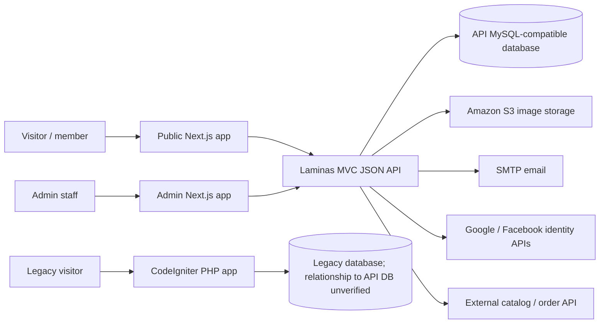
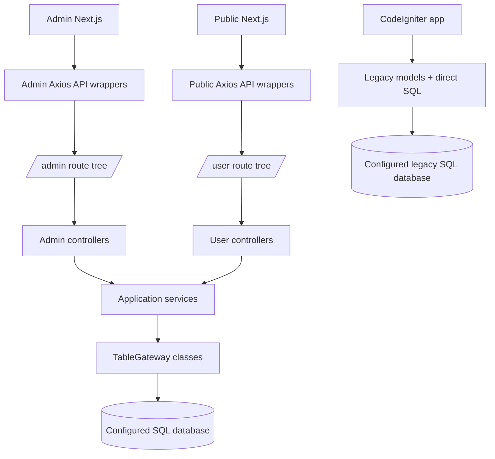
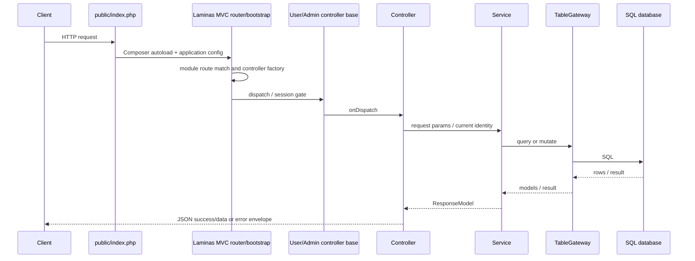

# Architecture

## High-Level System

## Module Dependencies

No source evidence establishes a direct import/runtime dependency between the legacy app and Laminas API.

## API Startup and Request Lifecycle

The API's common envelope is generated by `AbstractApplicationController`: `{success,data,success_msg,success_code}` or `{success,error_msg,error_code}`. Codes appear in the JSON body; HTTP status mapping requires runtime confirmation. POST parsing is JSON in `AbstractService`; PUT parsing uses `parse_str` on the request body.

## Deployment Evidence

- **CONFIRMED:** both Next apps have `amplify.yml`; admin/public API URLs default to a test API host. The admin app has a local override file template.
- **CONFIRMED:** API contains `Dockerfile`, `docker-compose.yml`, Vagrantfile, and a Composer built-in-server script. These are available deployment/dev options, not proof of production usage.
- **CONFIRMED:** `api/public/.htaccess` rewrites non-file requests to `index.php`; legacy CodeIgniter also uses Apache rewrite config.
- **UNVERIFIED:** actual hostnames, reverse-proxy `/api/public` mount, production database, cloud roles/buckets, TLS termination, CI/CD branch rules, worker fleet, cron, and deployment topology.
- No queue worker or scheduled-job implementation was established in this pass.