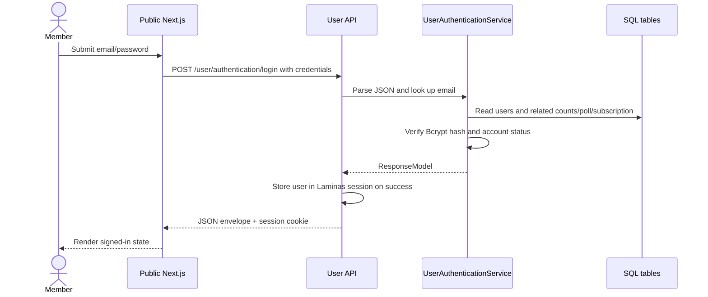
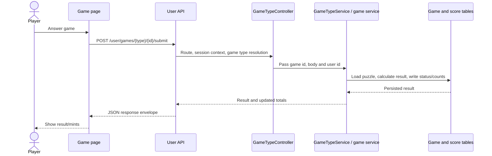
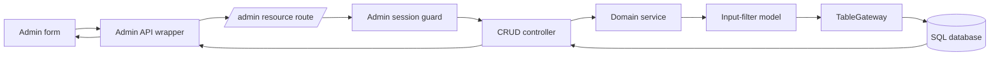
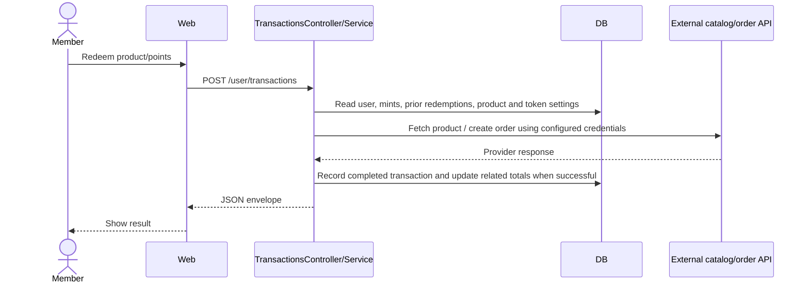

# Data Flow

All diagrams are source-derived. External calls, HTTP status mapping, and DB transactions require runtime verification.

## User Login and Session

Logout removes the user/admin value from the session container. No bearer-token issuance/validation path was found. Cookie/CORS behavior depends on deployment configuration.

## Game Submission (API)

Per-game scoring is not uniform. Grid and MatchPoint currently consume client-supplied correctness flags; validate server-side scoring before relying on this flow for rewards.

## Admin CRUD

Admin content create/update passes the current admin id to services for audit fields. The declared `checkPermission()` helper has no call sites in admin controllers; authenticated non-superadmin access may therefore exceed the permission map's apparent intent.

## Purchase / Redemption

Provider verification, idempotency, transaction boundaries, and retry behavior have not been observed. No payment webhook or background worker was established in this pass.