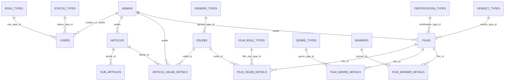

# ER Diagram

## Evidence Boundary

The diagram below models relationships explicitly found in SQL FK clauses. It is not a claim that this is the current production schema. Tables without a demonstrated FK remain in the table registry in [DATABASE_SCHEMA.md](DATABASE_SCHEMA.md), not connected by name-only guesses. The SQL corpus repeats clauses across migrations; the listed edges are normalized by source table/column and target table/column. Optionality and current nullability must be checked in the live schema.

## Core Content and Identity

## Games and Activity

```mermaid
erDiagram
    GAME_TYPES ||--o{ GAMES : game_type_id
    LEVEL_TYPES ||--o{ GAMES : level_type_id
    ADMINS ||--o{ GAMES : audits
    GAMES ||--o{ CROSSWORD_DETAILS : game_id
    GAMES ||--o{ GAME_CELEB_DETAILS : game_id
    CELEBS ||--o{ GAME_CELEB_DETAILS : celeb_id
    GAMES ||--o{ CROSSWORD_QUESTIONS : game_id
    GAMES ||--o{ CROSSWORD_STATUS : game_id
    GAMES ||--o{ FILL_ME_QUESTIONS : game_id
    GAMES ||--o{ FILL_ME_STATUS : game_id
    GAMES ||--o{ GRID_DETAILS : game_id
    GAMES ||--o{ GRID_QUESTIONS : game_id
    GAMES ||--o{ GRID_STATUS : game_id
    GAMES ||--o{ HI5_DETAILS : game_id
    GAMES ||--o{ HI5_STATUS : game_id
    GAMES ||--o{ JUMBLE_DETAILS : game_id
    GAMES ||--o{ JUMBLE_QUESTIONS : game_id
    GAMES ||--o{ JUMBLE_STATUS : game_id
    GAMES ||--o{ MATCH_POINT_DETAILS : game_id
    GAMES ||--o{ MATCH_POINT_QUESTIONS : game_id
    GAMES ||--o{ MATCH_POINT_STATUS : game_id
    GAMES ||--o{ MIXED_BAG_DETAILS : game_id
    GAMES ||--o{ MIXED_BAG_STATUS : game_id
    GAMES ||--o{ PIX_FIX_DETAILS : game_id
    GAMES ||--o{ PIX_FIX_STATUS : game_id
    GAMES ||--o{ QUIZ_OF_THE_WEEK_QUESTIONS : game_id
    GAMES ||--o{ QUIZ_OF_THE_WEEK_STATUS : game_id
    USERS ||--o{ CROSSWORD_STATUS : user_id
    USERS ||--o{ GRID_STATUS : user_id
    USERS ||--o{ HI5_STATUS : user_id
    USERS ||--o{ JUMBLE_STATUS : user_id
    USERS ||--o{ MATCH_POINT_STATUS : user_id
    USERS ||--o{ MIXED_BAG_STATUS : user_id
    USERS ||--o{ PIX_FIX_STATUS : user_id
    USERS ||--o{ QUIZ_OF_THE_WEEK_STATUS : user_id
    USERS ||--o{ GAMES_COUNT : user_id
    USERS ||--o{ MINTS_COUNT : user_id
    GAMES ||--o{ GAME_USER_RATINGS : game_id
    USERS ||--o{ GAME_USER_RATINGS : user_id
    GAMES ||--o{ GAME_RATINGS : game_id
    QUIZ_OF_THE_WEEK_QUESTIONS ||--o{ QUIZ_OF_THE_WEEK_STATUS : question_id
    MATCH_POINT_QUESTIONS ||--o{ MATCH_POINT_STATUS : question_id
```

## Relationship Classes

- **Database-enforced in migration SQL:** the edges shown above, including parent-to-detail/status rows and admin audit columns. The source DDL uses `ON UPDATE NO ACTION`; deletes/cascade rules are not established by these clauses.
- **Application-level/inferred:** `blogs`/categories/view tracking, referrals, subscriptions/transactions/products, badges, and some game-specific tables are related by query/model logic, but no corresponding FK was established in inspected migration lines. Treat as inferred only after tracing the exact query.
- **Uncertain:** any relationship in legacy CodeIgniter tables and any cross-application link. No live database or canonical legacy schema was inspected.

## Tables Without a Verified FK Edge

These gateway targets also exist but no FK edge was established in the inspected migration corpus. They are deliberately not connected by naming inference: `BADGES`, `BADGE_TYPES`, `BLOGS`, `BLOG_CATEGORIES`, `BLOG_VIEWS_TRACKING`, `CATEGORIES`, `CONTACTUS`, `DO_YOU_KNOW`, `GAME_SPONSERED_TYPES`, `META_TAGS`, `POLL_WEEK_QUESTIONS`, `POLL_WEEK_STATUS`, `PRODUCTS`, `RECORDS_ARCHIVE`, `REFERRAL_USERS`, `REVIEW_DETAILS`, `SPONSERED_GAME_STATUS`, `SUBSCRIPTIONS`, `TOKEN_SETTINGS`, `TRANSACTIONS`, `VIEW_ARTICLE_TRACKING`, and `SESSIONS`.

The diagrams and this standalone entity list cover the API gateway registry plus DB-backed sessions. Physical types, unique indexes, nullability, and all attributes must be checked against canonical DDL/live schema before change. The table-name registry in [DATABASE_SCHEMA.md](DATABASE_SCHEMA.md) is authoritative for the exact 70 gateway names.